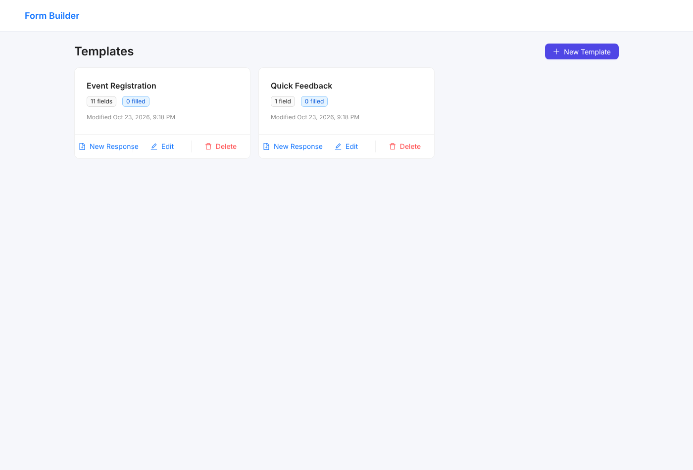
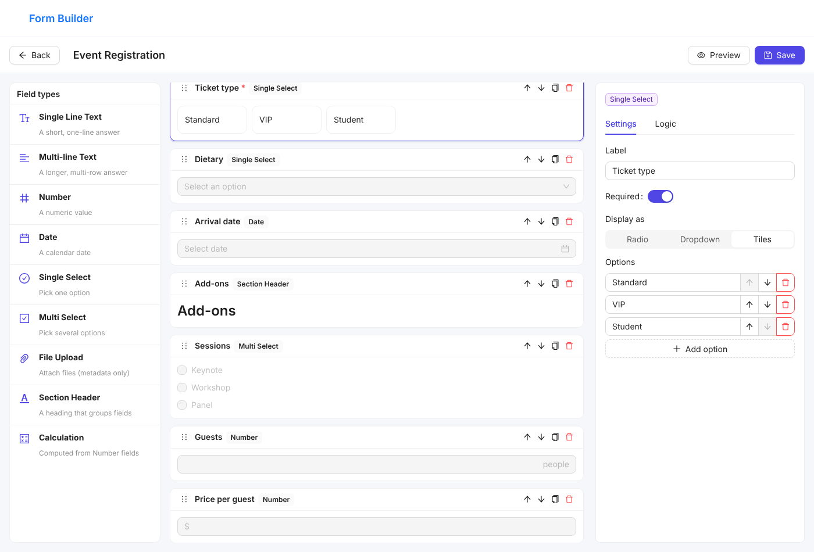
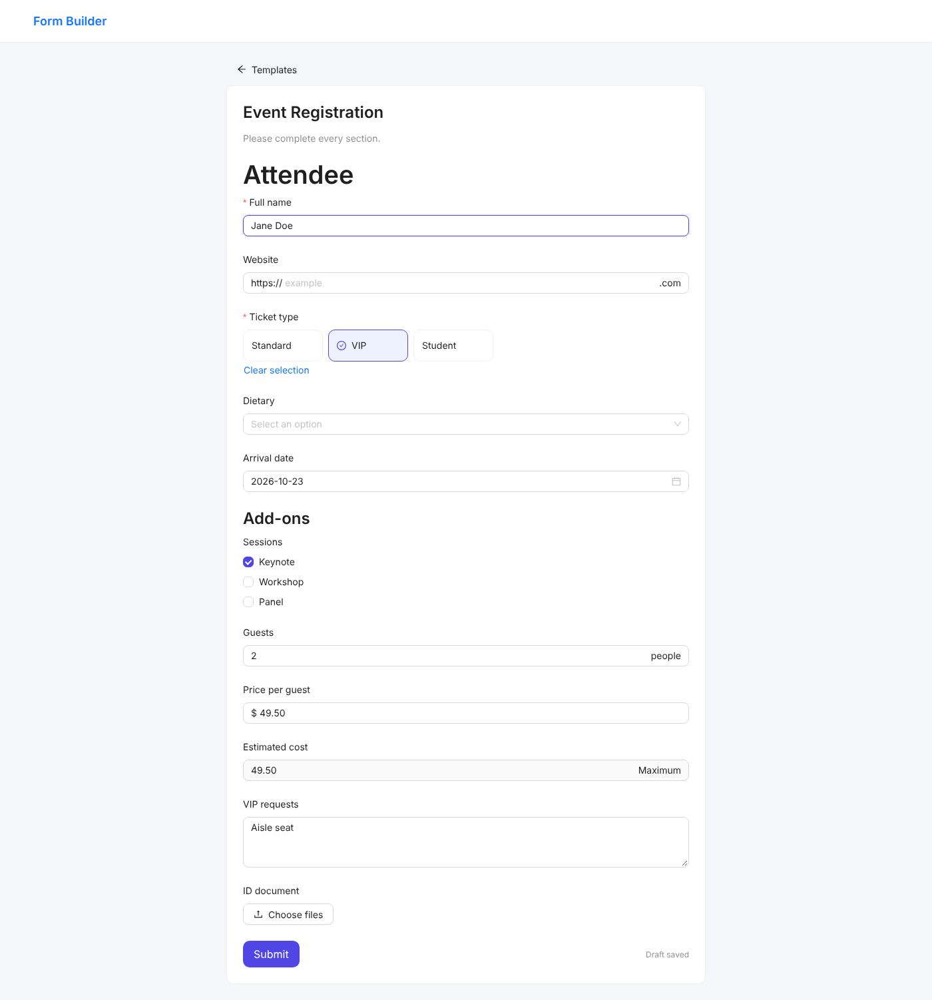
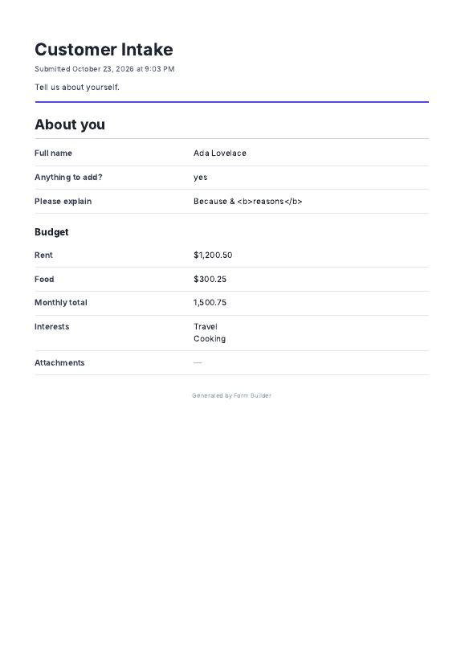

# Form Builder

A browser-only form builder in the spirit of Google Forms: design a form template, fill it out, and export the result as a PDF. React + TypeScript, no backend — everything lives in `localStorage`.

| Templates | Builder |
|---|---|
|  |  |
| **Fill mode** | **Exported PDF** |
|  |  |

## Run it

Requires **Node 22.12+** (`.nvmrc` provided).

```bash
npm install
npm run dev          # http://localhost:5173
```

| Command | Purpose |
|---|---|
| `npm run dev` / `npm run build` / `npm run preview` | Dev server / production build / serve the build |
| `npm run typecheck` · `npm run lint` | Strict TypeScript · ESLint (`any` is a lint error) |
| `npm test` | 110 unit/component tests (Vitest + React Testing Library) |
| `npm run e2e` | 10 end-to-end tests in real Chromium (Playwright) |
| `npm run test:all` | All of the above |

How to run, extend and manually verify the tests: **[docs/TESTING.md](docs/TESTING.md)**.
Log of how AI was used while building this: **[AI_USAGE.md](AI_USAGE.md)**.

## What it does

- **Templates list** — cards with title, field count, filled-response count and last-modified date; New Template, edit (click a card), New Response, delete (cascades to its responses, with confirmation).
- **Builder** — palette (click to add) · canvas (drag-and-drop *or* up/down buttons, duplicate, delete) · config panel · Save (validated) · Preview (sandbox modal) · unsaved-changes guard.
- **Fill mode** — real-time conditional visibility/required state and calculations, validation on submit (scrolls to the first error), debounced draft autosave that survives a refresh, submitted responses become read-only.
- **Responses** — per-template list of submitted responses (View, Re-download PDF, Delete) plus in-progress drafts (Resume, Discard).
- **PDF export** — browser-native, no PDF library (see [PDF export](#pdf-export)).

### Field types

The spec's list is numbered 1–10, but item 9 (*Conditional Logic*) is a feature that applies to every field, not a field type. So there are **9 field types** plus the logic engine:

Single Line Text · Multi-line Text · Number · Date · Single Select (Radio / Dropdown / Tiles) · Multi Select · File Upload (metadata only) · Section Header · Calculation.

## Architecture

```
src/
  domain/      Zod schemas + types for Template, Instance, Rule, Condition (no React)
  fields/      One folder per field type: model.ts (pure) + view.tsx (React)
               models.ts / views.ts = the two registries
  logic/       Pure engine: resolve visibility/required/values, validate, graph, template checks
  storage/     Typed localStorage repository (validated on read) + React hooks
  builder/     Builder page, canvas (dnd-kit), config panel, rule editor, reducer
  components/  FormRenderer (shared by Preview and Fill), FormPreview
  fill/        Fill reducer
  print/       Print model, printable document, print.css, iframe printing
  pages/       Home, Fill, Responses
e2e/           Playwright specs
```

Dependencies point one way: `domain` ← `fields/models` ← `logic` ← UI. **Nothing in `domain`, `logic` or `*/model.ts` imports React**, which is why the engine is exhaustively unit-testable without a DOM.

### Adding an 11th field type

Each type is a folder with a **model** (Zod config schema, defaults, `isEmpty`, `validateValue`, `format` for the PDF, which operator family rules may use against it) and a **view** (config panel + input). Registration is two lines:

```ts
// src/fields/models.ts            // src/fields/views.ts
email: emailModel,                 email: emailView,
```

`FieldType`, `FieldConfig` (a discriminated union), `FieldValue`, the palette, the config panel, validation, rule operators, persistence and the PDF all derive from those registries — there is no `switch (type)` outside a type's own folder. `views.ts` is typed as a mapped type over `FieldType`, so a missing view is a compile error.

This was tested rather than assumed: a throw-away `email` type (new folder + the two lines above) type-checked, linted, passed the suite and validated correctly in the real UI — **2 existing files touched, one line each**. It was then reverted because it's not in the spec.

The same applies to rule operators: a field picks one of the existing operator families (`text`, `number`, `singleSelect`, `multiSelect`, `date`). Only a genuinely new *kind* of comparison needs a new family in `domain/conditions.ts`.

### Type safety

- `strict` + `noUncheckedIndexedAccess`; ESLint forbids `any` (there is none in the code base).
- Zod schemas are the single source of truth: types are `z.infer`'d, and the same schemas validate everything read back from `localStorage`.
- Illegal states are unrepresentable where practical: a `Rule`'s `condition` is a discriminated union (`kind` → `operator` → value shape), so `number / contains / "abc"` doesn't compile; Section Header and Calculation have `required: z.literal(false)`.
- Casts are few and sit at validated boundaries: `modelOf` / `viewOf` (one each — the registry is a union of differently-typed models, so dispatching on `config.type` needs one `as unknown as`), the `FieldConfigSchema` transform (data was just validated by that type's schema), and a handful of UI event-handler narrowings (e.g. `RulesEditor.withOperator` checks the operator against the kind's table at runtime first).

## `localStorage` schema

Two keys, each a JSON object keyed by id:

```ts
'fb:v1:templates' → Record<TemplateId, Template>
'fb:v1:instances' → Record<InstanceId, Instance>

Template {
  id, title, description?, createdAt, updatedAt, schemaVersion: 1,
  fields: FieldConfig[]                       // ordered; array index IS the form order
}
FieldConfig = {                               // discriminated on `type`
  id, type, label,
  visible: boolean,                           // default visibility
  required: boolean,                          // default required state
  rules: Rule[],
  ...typeSpecificSettings
}
Rule { id, targetFieldId, effect: 'show'|'hide'|'require'|'unrequire', condition }
Condition = { kind, operator, value }         // e.g. {kind:'number', operator:'withinRange', value:{min,max}}

Instance {
  id, templateId, status: 'draft' | 'submitted',
  templateSnapshot: Template,                 // frozen copy taken when the response was started
  values: Record<fieldId, value>,
  createdAt, updatedAt, submittedAt?
}
// values: text → string · number → number · date → 'YYYY-MM-DD' · single select → option id
//         multi select → option id[] · file upload → {name,size,type}[] (metadata only)
```

Why:

- **Ordered array + stable ids.** Reordering or renaming a field never breaks a rule, calculation source or stored answer, because everything references ids, never positions or labels. Select options have ids too, so renaming "Option 1" doesn't invalidate answers or conditions.
- **Template snapshot inside every instance.** Editing or deleting a field later can't corrupt old responses or change a re-downloaded PDF. Cost: the template is duplicated per response (see limitations).
- **Dates as ISO `YYYY-MM-DD` strings.** No timezone drift, and they sort/compare lexicographically, which is what the date operators use. "Today" is the user's local date.
- **Validated on read.** Each entry is parsed with Zod; an entry that fails is skipped and counted (the Home page shows a notice) instead of crashing the app, and it is left untouched in storage. Writes catch quota errors and surface a toast.
- **Cross-tab:** a `storage` event listener refreshes lists when another tab writes.
- **Versioned keys** (`v1`) leave room for migrations. *Not implemented:* there is no migration code yet, only the version marker.

## Conditional logic

**Rules.** Every field has a default state (`visible`, `required`) and an ordered list of rules: *when [field] [operator] [value] → show / hide / mark required / mark not required*. Operators per target type follow the spec table exactly (`is within range` is inclusive).

**Multiple conditions — the AND/OR decision.** Neither. Visibility rules (`show`/`hide`) and required rules (`require`/`unrequire`) are **two independent axes**. On each axis, rules are applied **in list order and the last matching rule wins**; if none match, the default applies. Reasons: a field often needs *different* effects from different conditions ("show if A, and require if B"), which a single AND/OR toggle can't express; it is deterministic and explainable in one sentence; and "if X then show / if Y then hide" has an obvious resolution. The builder says so in the Logic tab.

**Empty targets never match.** If the field a rule reads has no value (empty, or hidden — see next point) the rule is simply *not matched* and the default applies. That includes negative operators: `does not equal "yes"` does **not** fire on an unanswered field, because no answer is not an answer (this is the spec's "when the target field has no value").

**Hidden fields contribute no value — chained conditions.** Fields are evaluated in dependency order (a topological sort over rule targets and calculation sources), and a hidden field exposes *no value* to other rules. So with A→shows→B→shows→C, hiding A hides B, and because B is hidden C hides too — even though the user typed an answer into B earlier. Order in the form doesn't matter (a rule may target a field further down). Tested both ways.

**Hidden ≠ validated ≠ exported.**
- A hidden field is **never validated**, even if its default or rule-derived state is "required".
- Its answer is **kept in the in-progress draft** (so flipping the condition back restores what the user typed), but is **dropped on submit** and never appears in stored submissions or the PDF.

**Guard rails (builder).** A field can't depend on itself; the rule-target dropdown doesn't offer fields that would create a loop (they appear disabled, "would loop"); Save re-checks for cycles. Deleting a field, or removing a select option, automatically removes the rules/calculation sources that referenced it. Section Headers and Calculations can be shown/hidden by rules but can't be made required.

Other details: text comparisons are trimmed and case-insensitive (`contains` included); a Calculation can be a rule *target* (compared as a number).

### Calculation

Sum / Average / Minimum / Maximum over chosen Number fields, rounded to its own decimal setting, recomputed on every keystroke and read-only. Sources must be Number fields — never another Calculation (not selectable, and rejected on save). **Hidden and empty sources are ignored**; `0` counts as a value; if no source has a value the result is empty (not `0`). The computed value is stored with a submitted response as a snapshot.

## PDF export

Spec: *browser-native APIs only*. **Decision: a print stylesheet + `window.print()`**, driven through a hidden `<iframe>` so it works the same from the fill page and from the responses list, long after the response was created.

- `buildPrintModel` (pure, tested) turns a stored response into the document: title, submission timestamp, description, then **visible fields in form order** — hidden fields don't exist in it. Section headers keep their five-size hierarchy; multi-select prints one choice per line; empty optional fields print `—`; file fields print `name (size, type)` plus *"File contents are not embedded"*.
- `print.css` sets A4 + margins, keeps each row together across page breaks, wraps long titles and unbroken strings, and keeps a heading with the row that follows.
- The page title is set to `<Form title> – <date>` while printing so "Save as PDF" proposes a sensible file name.

Trade-off, stated plainly: this opens the browser's print dialog and the user picks **Save as PDF** — it is *not* a silent file download. I weighed hand-writing a PDF byte stream (a true download, but ~300 lines, Latin-1 text only, fragile layout) against the print route (real typography, full Unicode, automatic pagination, far less code to get wrong) and chose the latter. Verified by rendering the exact exported document to PDF in Chromium: a one-page form, and a 60-field form that flows onto 8 A4 pages without splitting a row.

## Product decisions (where the spec is silent)

| Question | Decision |
|---|---|
| Deleting a template | Also deletes its responses (confirmation says how many). |
| Editing a template that has responses | Existing responses keep their own snapshot and are unaffected. |
| "New Response" then refresh | A draft is created immediately and autosaves; it survives refresh and appears under *In progress*. Drafts don't count as "filled". |
| Editing after submit | Submitted responses are read-only. |
| When do errors appear? | Never on first paint; after a field is edited, or after a submit attempt. |
| "Number of fields" on a card | Counts data fields; Section Headers are layout and excluded. |
| Number decimals | The configured places are enforced on entry: with **0** places (the default), typing `2.5` becomes `3`. Raise the setting for fractional values. |
| Min/max length, min/max selections, number/date bounds | Only apply once there is a value; "required" is the separate toggle. |
| File upload | Only `{name, size, type}` is stored. Extensions are normalised (`PDF, .png` → `.pdf, .png`); empty list = any type; type and count are validated on submit. |
| Select options | Need ≥ 1, unique (case-insensitive), non-empty; answers/conditions reference option ids. |
| Calculation with nothing to calculate | Empty, not 0. |
| Template title | Required to save. Empty-label fields and min > max settings also block Save, with the reason shown. |
| Unsaved builder changes | Guarded on in-app navigation (route blocker) and on tab close. |
| A form of only Section Headers | Can be submitted. |

## Known limitations / what I'd do with more time

- **Storage footprint.** The per-response template snapshot trades space for correctness; `localStorage` is ~5 MB. Next step: de-duplicate identical snapshots by content hash, or move to IndexedDB.
- **No migrations** beyond the `v1` key / `schemaVersion` marker, and **last write wins** across tabs (no conflict detection when two tabs edit the same template).
- **PDF** is the print dialog, not a one-click file; no custom headers/footers or page numbers (browsers add their own).
- **Builder:** no undo/redo, no drag-from-palette (click to add), no template duplication or import/export.
- **Bundle** is a single ~1 MB chunk (antd); route-level code splitting would help first load.
- **Accessibility** was designed for (labels wired to controls, keyboard-operable tiles and drag handles, visible focus) but not formally audited with a screen reader.
- **Rule UX:** rules are edited per field; there is no whole-form graph view of dependencies.
- Rule ids/targets are validated on save, but a template hand-edited in DevTools into a cyclic state is tolerated (evaluation always terminates) rather than repaired.

## Tech stack

Vite · React 18 · TypeScript (strict) · Ant Design 5 (components and theming, as the spec leaves styling open) · Zod · React Router 6 (data router, for the unsaved-changes blocker) · dnd-kit · Vitest + Testing Library · Playwright.
