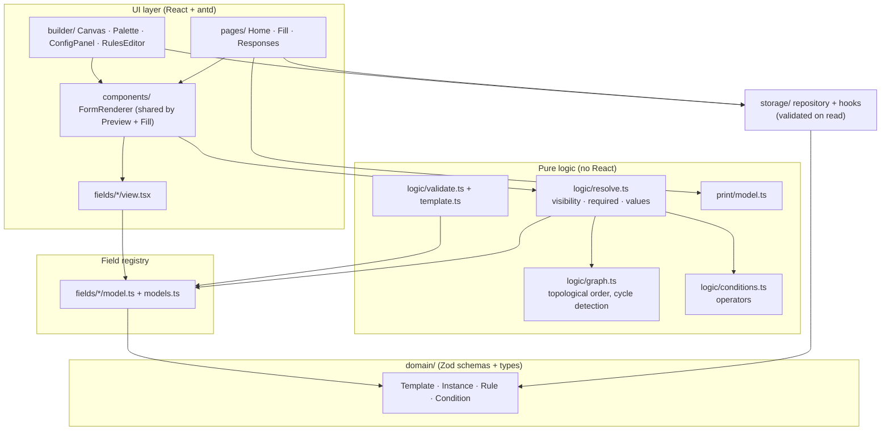
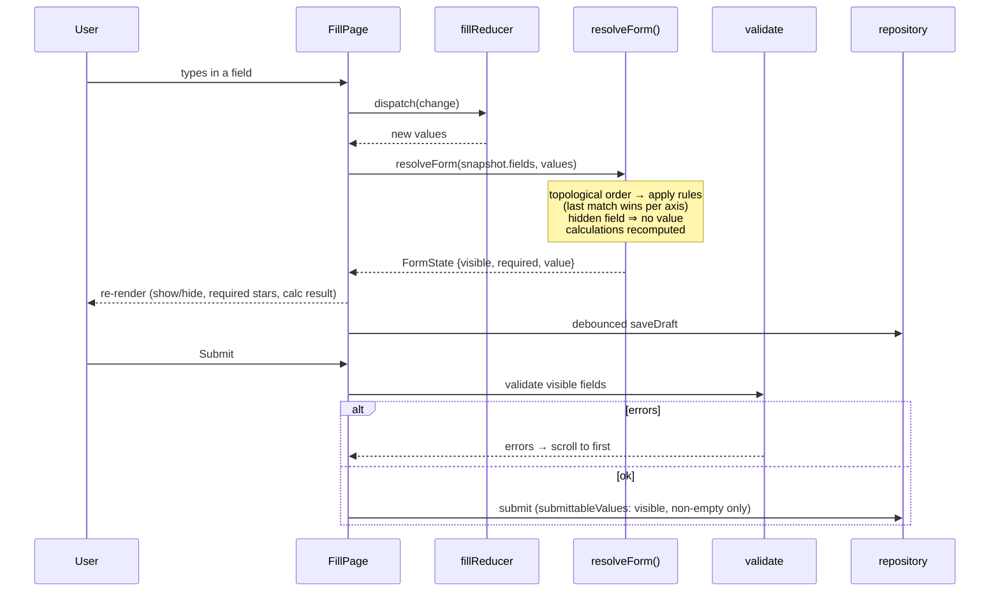
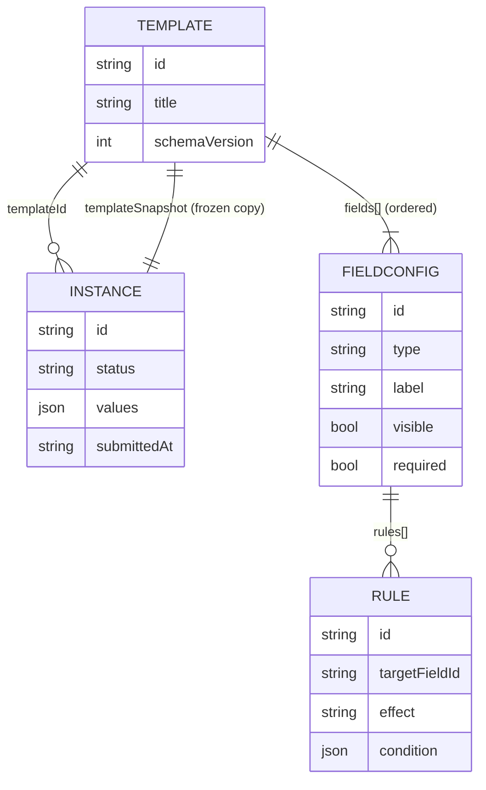
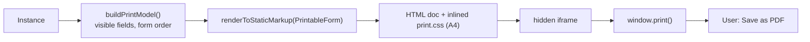
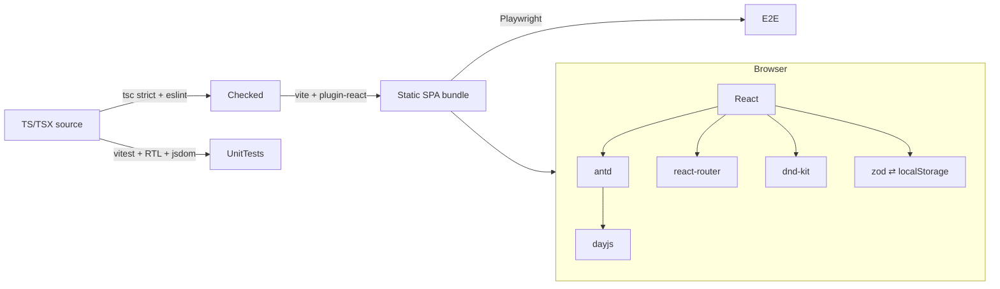

# Form Builder — Technical Document

A browser-only form builder (Google Forms style): **design a template → fill it out → export a PDF**. React + TypeScript, no backend; all data lives in `localStorage`. (Diagrams use Mermaid; GitHub renders them.)

## 1. Product flow

```mermaid
flowchart TD
    Home["Home /<br/>template cards"] -->|New Template / click card| Builder["Builder /builder/:id"]
    Builder -->|Save (Zod + cycle check)| TplStore[("localStorage<br/>fb:v1:templates")]
    Home -->|New Response| Draft["Create draft Instance<br/>(+ templateSnapshot)"]
    Draft --> Fill["Fill /fill/:instanceId"]
    Fill -->|debounced autosave| InstStore[("localStorage<br/>fb:v1:instances")]
    Fill -->|Submit: validate visible fields| Submitted["status = submitted<br/>(read-only, hidden values dropped)"]
    Submitted --> InstStore
    Home -->|Responses| Resp["Responses /templates/:id/responses"]
    Resp -->|View| Fill
    Resp -->|Resume / Discard draft| Fill
    Resp -->|Download PDF| Print["printInstance()<br/>hidden iframe + window.print()"]
    Fill -->|Download PDF| Print
    Print --> PDF["Browser print dialog<br/>→ Save as PDF"]
    Home -->|Delete template| Cascade["Delete template<br/>+ its responses"]
```

## 2. Layered architecture

Dependencies point one way. Nothing in `domain`, `logic` or `fields/*/model.ts` imports React, so the engine is unit-testable without a DOM.



| Folder | Responsibility |
|---|---|
| `src/domain/` | Zod schemas + inferred types for Template, Instance, Rule, Condition; ids; date helpers |
| `src/fields/` | One folder per field type: `model.ts` (config schema, defaults, `isEmpty`, `validateValue`, PDF `format`, operator family) and `view.tsx` (config UI + input). `models.ts` / `views.ts` are the two registries |
| `src/logic/` | Pure engine: `resolveForm` (visible/required/value per field), dependency graph, condition operators, validation, template checks |
| `src/storage/` | Typed `localStorage` repository, validated on read; `useSyncExternalStore` hooks; cross-tab `storage` event sync |
| `src/builder/` | Builder page, dnd-kit canvas, config panel, rule editor, `builderReducer` |
| `src/fill/` | `fillReducer` (values, touched, submitAttempted) |
| `src/components/` | `FormRenderer` — one renderer shared by Preview and Fill |
| `src/print/` | `buildPrintModel`, `PrintableForm`, `print.css`, iframe printing |
| `src/pages/` | Home, Fill, Responses |
| `e2e/` | Playwright specs |

## 3. Runtime: how a keystroke becomes UI



### Conditional-logic rules (summary)
- Each field has default `visible`/`required` plus ordered `rules` (*when [field] [operator] [value] → show/hide/require/unrequire*).
- Visibility and required are **independent axes**; per axis the **last matching rule wins**.
- A rule on an empty or hidden target never matches → defaults apply; chained conditions (A→B→C) therefore cascade.
- Hidden fields are never validated; their values stay in the draft but are dropped on submit and in the PDF.
- Builder prevents self-dependency and cycles (disabled "would loop" targets; re-checked on save).

## 4. Data model (`localStorage`)



- Keys: `fb:v1:templates`, `fb:v1:instances` (each a JSON object keyed by id).
- Everything references **ids**, never positions/labels, so reorder/rename never breaks rules or answers.
- Each response embeds a **template snapshot** so later template edits cannot corrupt old responses or re-downloaded PDFs.
- Dates are `YYYY-MM-DD` strings; select answers are option ids; file upload stores metadata only.
- Invalid entries on read are skipped, counted, and left in storage; quota errors surface as a toast.

## 5. Field types (9) and extensibility

Single Line Text · Multi-line Text · Number · Date · Single Select (radio/dropdown/tiles) · Multi Select · File Upload (metadata) · Section Header · Calculation (sum/avg/min/max over Number fields).

Adding a type = new folder (`model.ts` + `view.tsx`) + one line in each registry. `FieldType`, `FieldConfig`, validation, palette, operators, persistence and PDF derive from the registries; `views.ts` is a mapped type, so a missing view fails to compile.

## 6. PDF export


Browser-native only (no PDF library). Trade-off: opens the print dialog rather than a silent download; gains real typography, Unicode and automatic pagination.

## 7. Libraries and their purpose

### Runtime dependencies
| Library | Purpose in this project |
|---|---|
| **react**, **react-dom** (18) | UI rendering; `renderToStaticMarkup` (react-dom/server) also builds the printable HTML |
| **react-router-dom** (6) | Routing. A *data router* (`createBrowserRouter`) is used because `useBlocker` powers the unsaved-changes guard |
| **antd** (5) | Component library and theming (forms, inputs, modals, cards, layout, message/toast) |
| **@ant-design/icons** | Icons for buttons and actions |
| **zod** (3) | Single source of truth for types (`z.infer`) and runtime validation of anything read from `localStorage` |
| **@dnd-kit/core**, **sortable**, **utilities** | Accessible drag-and-drop reordering of fields on the builder canvas |
| **dayjs** | Date handling (antd's date picker adapter; local "today", ISO date conversion) |

### Build / quality tooling
| Library | Purpose |
|---|---|
| **vite** + **@vitejs/plugin-react** | Dev server and production bundler (also `?inline` import of `print.css`) |
| **typescript** (strict, `noUncheckedIndexedAccess`) | Static typing; `tsc -b` runs before build |
| **eslint**, **@eslint/js**, **typescript-eslint**, **eslint-plugin-react-hooks**, **globals** | Linting; `any` is an error, hooks rules enforced |
| **@types/node, react, react-dom** | Type definitions |

### Testing
| Library | Purpose |
|---|---|
| **vitest** + **jsdom** | Unit/component test runner and DOM environment (110 tests) |
| **@testing-library/react**, **user-event**, **jest-dom** | Render components, simulate users, DOM matchers |
| **@playwright/test** | End-to-end tests in real Chromium (10 specs, incl. builder→PDF) |

## 8. Libraries in the pipeline



## 9. Testing & commands

| Command | Purpose |
|---|---|
| `npm run dev` / `build` / `preview` | Dev server / production build / serve build |
| `npm run typecheck`, `npm run lint` | Strict TS, ESLint |
| `npm test` | Vitest unit + component tests |
| `npm run e2e` | Playwright (server on port 5199) |
| `npm run test:all` | All of the above |

Node ≥ 22.12 (`.nvmrc`). See `docs/TESTING.md` for details.

## 10. Known limitations
`localStorage` size (~5 MB, snapshot per response); no schema migrations; last-write-wins across tabs; PDF via print dialog; no undo/redo, template duplication/import; single ~1 MB bundle; accessibility not formally audited.
